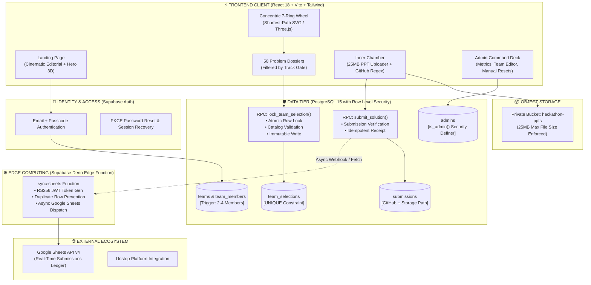
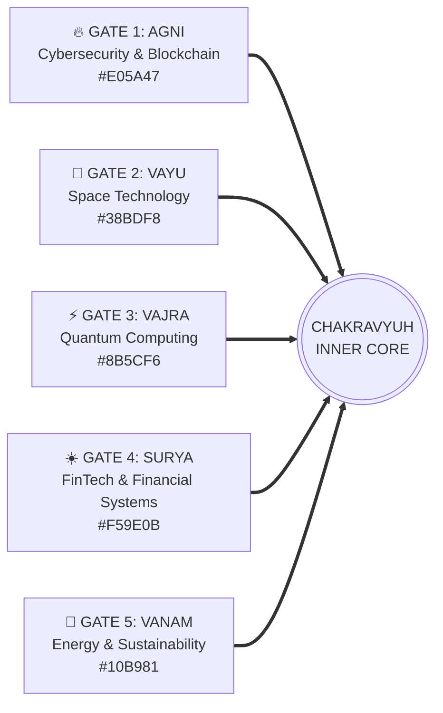
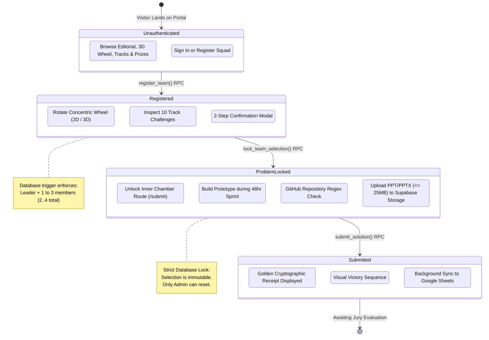
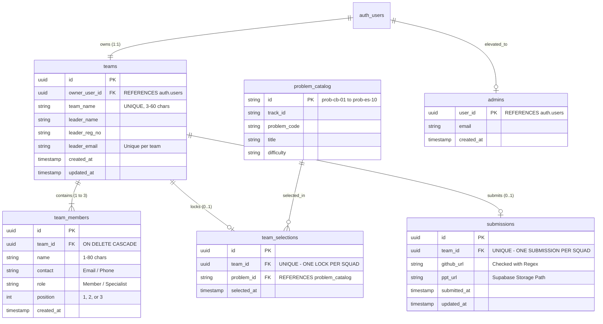
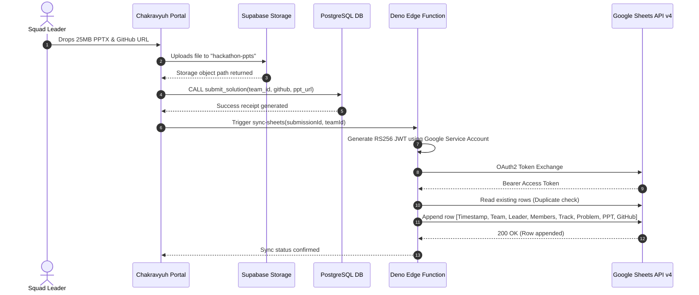

<div align="center">

  

  # ⚔️ CHAKRAVYUH 2026 ⚔️
  ### THE ANCIENT LABYRINTH OF INNOVATION // VIT-AP EDITION

  <p align="center">
    <em>"Every great solution begins with the courage to enter."</em><br />
    An ancient strategic military formation engineered into a cutting-edge 48-hour competitive cyber-arena.<br />
    Hosted at <strong>VIT-AP University</strong> &middot; Powered by <strong>Unstop</strong> &middot; Supported by <strong>IIEC, Notion, Qualium AI, & Pocket Lab</strong>
  </p>

  <p align="center">
    <a href="https://react.dev"></a>
    <a href="https://www.typescriptlang.org"></a>
    <a href="https://vitejs.dev"></a>
    <a href="https://tailwindcss.com"></a>
    <a href="https://threejs.org"></a>
    <a href="https://supabase.com"></a>
    <a href="https://framer.com/motion"></a>
    <a href="https://developers.google.com/sheets/api"></a>
  </p>

  <p align="center">
    
    
    
    
    
    
  </p>

---

  ### ⚡ [Explore Arena](#-battle-gates--domains) &bull; [System Architecture](#-system-architecture) &bull; [Participant Journey](#-participant-lifecycle--state-machine) &bull; [Database & RLS](#-security-model--database-schema) &bull; [Quickstart](#-developer-quickstart) &bull; [Edge Functions](#-google-sheets-synchronization-edge-function) &bull; [Admin Console](#-administrative-command-deck)

---

</div>

<br />

## 🌟 Executive Summary

**CHAKRAVYUH** is an enterprise-grade hackathon management and competition portal engineered for high-concurrency national collegiate events. Built for **VIT-AP University**, it reinterprets the ancient, impenetrable multi-tier military labyrinth from Indian epic lore into a high-octane digital arena.

Unlike standard forms or static hackathon listing sites, Chakravyuh is an **interactive visual experience** combining:
1. **Concentric 7-Ring Shortest-Path Rotation Engine**: A mathematically calibrated 2D Canvas/SVG wheel and interactive 3D Three.js WebGL arena.
2. **5 Specialized Battle Gates with Custom Cultural Atmospheres**: Dynamic GPU-accelerated backdrop particle systems (Agni, Vayu, Vajra, Surya, Vanam).
3. **50 Granular Problem Statements**: Categorized dossiers with evaluation criteria, suggested technology stacks, and direct dataset links.
4. **Ironclad Database-Level Atomic Locks**: Zero-trust PostgreSQL Row Level Security (RLS) and stored procedures guaranteeing **strictly one immutable problem lock** per team.
5. **Inner Chamber Submission Pipeline**: Real-time GitHub regex validation, 25MB PowerPoint binary stream directly to Supabase Storage, and instantaneous automated synchronization to Google Sheets via serverless Deno Edge Functions with RS256 JWT auth.
6. **Zero-Mock Production Integrity**: Strict rejection of guest or mock data; every squad is authenticated and backed by real PostgreSQL records.

```
┌────────────────────────────────────────────────────────────────────────────────────────┐
│                               CHAKRAVYUH METRIC MATRIX                                 │
├────────────────────┬────────────────────┬────────────────────┬─────────────────────────┤
│    TOTAL PRIZE     │   DURATION & MODE  │   SQUAD CAPACITY   │      SYSTEM STATUS      │
│     ₹7,00,000      │   48 Hours (Onsite)│   2 to 4 Members   │  100% Production Ready  │
│  Cash + Incubator  │   VIT-AP Amaravati │   Strict DB Trigger│  Zero Mock Mode Allowed │
└────────────────────┴────────────────────┴────────────────────┴─────────────────────────┘
```

---

## 🏛️ System Architecture

Chakravyuh separates participant interactions, state mutations, file storage, and administrative telemetry into isolated layers:



---

## 🌀 Battle Gates & Domains

The labyrinth is structured into **5 elemental battle gates**. Each gate commands a distinct aesthetic, background atmosphere, soundscape identity, and ten specialized challenges:



| Gate | Elemental Theme | Domain Focus | Primary Colors | Flagship Problem Preview |
|:---:|:---:|:---|:---:|:---|
| **01** | **AGNI** *(Fire)* | **Cybersecurity & Blockchain**<br/>Zero-Trust Bastions & Decentralized Ledgers | `Ember Red`<br/>`#E05A47` | **BridgeWatch**: Cross-chain bridge exploit early warning with sub-30s anomaly detection and automated circuit breakers. |
| **02** | **VAYU** *(Wind)* | **Space Technology**<br/>Orbital Telemetry, Satellites & Aerospace | `Electric Sky`<br/>`#38BDF8` | **OrbitNet**: Decentralized satellite constellation mesh routing with resilient high-latency CRDT synchronization. |
| **03** | **VAJRA** *(Lightning)* | **Quantum Computing**<br/>Superposition, Coherence & Hybrid Algorithms | `Quantum Violet`<br/>`#8B5CF6` | **Q-Shield**: Hybrid post-quantum cryptographic key encapsulation and NISQ-friendly error mitigation algorithms. |
| **04** | **SURYA** *(Sun)* | **FinTech Systems**<br/>Smart Ledgers, Fraud Graphs & Vernacular Rails | `Solar Amber`<br/>`#F59E0B` | **GraphSentinel**: Graph neural network real-time AML and mule account cluster detection across high-velocity UPI streams. |
| **05** | **VANAM** *(Earth/Flora)* | **Energy & Sustainability**<br/>Clean Energy Grids, Microgrids & Climate AI | `Emerald Green`<br/>`#10B981` | **GridSense**: Decentralized solar microgrid peer-to-peer energy dispatch with predictive battery wear scheduling. |

---

## 🔄 Participant Lifecycle & State Machine

Each squad navigates an unyielding progressive path through the Chakravyuh. State mutations are guarded by PostgreSQL transactional logic:



---

## 🗄️ Security Model & Database Schema

Chakravyuh utilizes a **Zero-Client Mutation** architecture. Participants possess `SELECT` access scoped exclusively to their own team; all modifications occur via `SECURITY DEFINER` stored procedures.

### Entity Relationship Diagram



### PostgreSQL Access Control Matrix

| Table / Resource | Anonymous | Squad Member | Squad Leader (Owner) | Platform Admin | Enforced By |
|---|:---:|:---:|:---:|:---:|---|
| **`teams`** | Denied | `SELECT` (Own Team) | `SELECT` (Own Team) | Full Access | RLS + `owner_user_id = auth.uid()` |
| **`team_members`** | Denied | `SELECT` (Own Team) | `SELECT` (Own Team) | Full Access | RLS + `enforce_team_size()` Deferred Trigger |
| **`problem_catalog`** | `SELECT` | `SELECT` | `SELECT` | Full Access | Public Catalog RLS |
| **`team_selections`** | Denied | `SELECT` (Own Lock) | Insert via `lock_team_selection()` | Admin Reset | Strict UNIQUE constraint + Atomic RPC |
| **`submissions`** | Denied | `SELECT` (Own Sub) | Insert via `submit_solution()` | Admin Reset | Storage Policy + Atomic RPC |
| **`hackathon-ppts`** | Denied | `SELECT` (Own File) | `INSERT` (File <= 25MB) | Full Access | Supabase Storage Bucket Security Rules |

> [!IMPORTANT]
> **Database-Enforced Squad Size**: Unlike naive forms that validate in JavaScript, Chakravyuh enforces the **2 to 4 member rule** directly within PostgreSQL using a deferred constraint trigger (`enforce_team_size`). Any transaction violating this boundary is immediately rolled back by the database engine.

---

## 🎨 Interactive UI & 3D Engineering Showcase

### 1. Dual-Engine Chakravyuh Wheel
- **Geometric 2D Wheel**: 7 concentric SVG labyrinth rings featuring shortest-path angular math. Clicking any gate smoothly spins the wheel clockwise or counter-clockwise across the shortest angular distance, aligning the selected gateway precisely to the 12 o'clock portal position.
- **Three.js WebGL Arena**: Procedural 3D models for each gate (`buildCyberGate`, `buildSpaceGate`, `buildQuantumGate`, `buildFintechGate`, `buildEnergyGate`), lit by simulated HDRI `RoomEnvironment`, responsive to orbit controls and mouse gestures.
- **Accessibility First**: Respects `prefers-reduced-motion` to smoothly disable rotations for sensitive users without degrading functionality.

### 2. Strict Two-Step Confirmation Modal
Accidental clicks are lethal in hackathons. Selecting a problem triggers a high-visibility modal requiring:
1. Review of the selected track, problem title, and difficulty badge.
2. Explicit checkbox acknowledgment that **once locked, the selection cannot be undone or switched**.
3. Cryptographic commit via the atomic database RPC.

### 3. Golden Sealed Submission Receipt
Upon solution submission:
- Generates a gilded receipt ticket featuring team metadata, timestamp, GitHub repository link, and storage receipt ID.
- Automatically triggers a canvas-confetti particle cascade.
- Displays download / print options for team record-keeping.

---

## 📊 Google Sheets Synchronization (Edge Function)

Submissions trigger an asynchronous dispatch to a **Supabase Deno Edge Function** (`supabase/functions/sync-sheets`).



---

## 🛠️ Developer Quickstart

### Prerequisites
- **Node.js**: `v18.0.0` or higher (tested on Node 20 & Node 24)
- **Package Manager**: `npm`, `pnpm`, or `yarn`
- **Supabase Project**: Free or Pro tier project on [supabase.com](https://supabase.com)
- **Google Cloud Platform (Optional)**: For real-time Google Sheets streaming

### 1. Clone & Install Dependencies

```bash
# Clone the repository
git clone https://github.com/your-username/chakravyuh-portal.git
cd chakravyuh-portal/Chakravyuh-hackathon

# Install exact dependencies
npm install
```

### 2. Environment Variables Configuration

Copy `.env.example` to create your local `.env`:

```bash
cp .env.example .env
```

Fill in your configuration credentials:

```env
# ------------------------------------------------------------------------------
# SUPABASE CONFIGURATION (MANDATORY)
# ------------------------------------------------------------------------------
VITE_SUPABASE_URL=https://your-project-id.supabase.co
VITE_SUPABASE_PUBLISHABLE_KEY=your-supabase-anon-or-publishable-key

# ------------------------------------------------------------------------------
# SPLINE 3D SCENE (OPTIONAL)
# ------------------------------------------------------------------------------
VITE_SPLINE_SCENE_URL=https://prod.spline.design/6Wq1Q7YGyM-iab9i/scene.splinecode
```

### 3. Initialize Database Schema

1. Open your **Supabase Dashboard** &rarr; **SQL Editor**.
2. Open [`supabase/migrations/20250101000000_chakravyuh_schema.sql`](./supabase/migrations/20250101000000_chakravyuh_schema.sql).
3. Copy and run the entire file. It is **100% idempotent** and safe to re-run.

### 4. Create an Admin User

1. In Supabase Dashboard, go to **Authentication** &rarr; **Users** &rarr; **Add User**.
2. Enter your admin email and password (e.g. `admin@vitap.ac.in`).
3. In the SQL Editor, promote this user to admin status:

```sql
INSERT INTO public.admins (user_id, email)
SELECT id, email FROM auth.users WHERE email = 'admin@vitap.ac.in'
ON CONFLICT (user_id) DO NOTHING;
```

### 5. Launch Development Server

```bash
npm run dev
```

The portal will launch at `http://localhost:5173`.

---

## ⚡ Administrative Command Deck

The administrative console is located at `/admin` (deliberately unlinked from public navigation).

```
╔══════════════════════════════════════════════════════════════════════════════════════╗
║ CHAKRAVYUH ADMIN CONSOLE                                          [STATUS: ONLINE]  ║
╠══════════════════════════════════════════════════════════════════════════════════════╣
║ TOTAL SQUADS: 142  │  LOCKED CHOICES: 128  │  SUBMISSIONS: 94  │  ARENA: ACTIVE      ║
╠══════════════════════════════════════════════════════════════════════════════════════╣
║ [ SEARCH TEAMS ] [ FILTER BY TRACK: ALL ▼ ] [ EXPORT CSV ] [ SYNC GOOGLE SHEETS ]  ║
║                                                                                      ║
║  ID   │ SQUAD NAME      │ TRACK    │ PROBLEM │ PPT   │ GITHUB │ ACTIONS              ║
║ ──────┼─────────────────┼──────────┼─────────┼───────┼────────┼────────────────────  ║
║ #0104 │ CyberSentinels  │ AGNI     │ CB-01   │ [PPT] │ [REPO] │ [Edit] [Reset Lock]  ║
║ #0105 │ OrbitalPioneers │ VAYU     │ ST-04   │ [PPT] │ [REPO] │ [Edit] [Reset Lock]  ║
║ #0106 │ QuantumCore     │ VAJRA    │ QC-07   │ [PPT] │ [REPO] │ [Edit] [Reset Lock]  ║
╚══════════════════════════════════════════════════════════════════════════════════════╝
```

### Admin Capabilities:
- **Real-Time Telemetry**: Aggregated counts of registered squads, locked problems, submissions, and track distribution.
- **Roster Management**: Edit squad names, update member emails, reassign positions, or remove invalid squads.
- **Lock & Submission Resets**: Clear accidental problem locks or allow a squad to re-submit presentation files.
- **CSV & Sheet Export**: One-click export of complete hackathon roster with direct download links for jury members.

---

## 📁 Repository Structure

```
chakravyuh-portal/
├── public/                               # Static high-res assets & brand vectors
│   ├── chakravyuh-luxury-wheel.svg       # Signature gold & crimson Chakravyuh emblem
│   ├── vit-ap-logo.png                   # Host institution official insignia
│   ├── unstop-logo-transparent.png       # Powered-by platform sponsor logo
│   └── acs.jpeg                          # Association of Computer Science club badge
├── src/
│   ├── assets/                           # Bundled vector graphics
│   ├── components/                       # Reusable UI modules
│   │   ├── admin/                        # TeamEditorModal & admin management panels
│   │   ├── cultural-backgrounds/         # Agni, Vayu, Vajra, Surya, Vanam GPU backdrops
│   │   ├── landing/                      # Hero, Tracks, Rules, Prizes, Sponsors, Venue
│   │   ├── navigation/                   # Tactical PillNav floating navigation bar
│   │   ├── ChakravyuhWheel.tsx           # 2D concentric 7-ring shortest-path SVG engine
│   │   ├── ChakravyuhWheel3D.tsx         # Three.js WebGL procedural gate scene
│   │   ├── SplineChakravyuh.tsx          # Spline 3D viewport fallback wrapper
│   │   ├── ConfirmationModal.tsx         # Strict 2-step immutable lock dialog
│   │   ├── SubmissionReceipt.tsx         # Sealed golden certificate with confetti blast
│   │   └── ProgressSteps.tsx             # Breadcrumb arena state indicator
│   ├── config/
│   │   └── hackathonConfig.ts            # Central manifest: Tracks, 50 Problems, Rules
│   ├── context/
│   │   └── AuthContext.tsx               # Supabase session provider & team resolution
│   ├── lib/
│   │   ├── dataService.ts                # PostgreSQL RPC wrapper & data mappings
│   │   ├── supabase.ts                   # Supabase client singleton & configuration check
│   │   └── teamRules.ts                  # Pure functional roster validation (2-4 squad)
│   ├── pages/                            # Top-level view routes
│   │   ├── LandingPage.tsx               # Grand entrance & public event information
│   │   ├── LoginPage.tsx                 # Team registration & authentication portal
│   │   ├── TrackSelectionPage.tsx        # 7-ring concentric gateway navigation
│   │   ├── ThemeDetailPage.tsx           # Deep dive into individual gate specifications
│   │   ├── ProblemSelectionPage.tsx      # 50 problem dossiers & atomic lock trigger
│   │   ├── SubmissionPage.tsx            # Inner Chamber PPT upload & GitHub commit
│   │   ├── AdminPage.tsx                 # Unlinked organizer command center
│   │   └── ResetPasswordPage.tsx         # Auth recovery endpoint
│   ├── types/
│   │   └── index.ts                      # Strict TypeScript interfaces
│   ├── App.tsx                           # Main router & configuration fallback guard
│   └── main.tsx                          # React 18 DOM mount point
├── supabase/
│   ├── functions/
│   │   └── sync-sheets/                  # Deno Edge Function for Google Sheets integration
│   │       └── index.ts                  # RS256 JWT auth + Sheets API v4 append
│   └── migrations/
│       └── 20250101000000_chakravyuh_schema.sql # Complete PostgreSQL DDL & RLS rules
├── tailwind.config.js                    # Custom theme colors, fonts & animations
├── vite.config.ts                        # Vite build optimizations
└── package.json                          # Dependencies & build scripts
```

---

## 🏆 Organizing Bodies & Ecosystem Partners

<div align="center">

| Institution / Partner | Role | Focus |
|:---:|:---:|:---|
| **VIT-AP University** | **Host Institution** | School of Computer Science & Engineering (SCOPE). |
| **Unstop** | **Platform Partner** | National registration reach & participant verification. |
| **Association of Computer Science (ACS)** | **Co-Hosting Club** | Technical systems operation, infrastructure & arena management. |
| **IQuest Developer Society** | **Community Partner** | Developer engagement, peer mentorship & participant logistics. |
| **Qualium AI** | **AI Partner** | Category leading intelligence tracks & model evaluation. |
| **Notion** | **Productivity Partner** | Squad collaboration spaces & project templates. |
| **Pocket Lab** | **Hardware Partner** | Embedded IoT kits, sensors & development boards. |
| **IIEC** | **Incubation Partner** | Direct incubation pipeline for top championship prototypes. |

</div>

---

<div align="center">

  <sub>Crafted with architectural precision for the warriors of code.</sub><br />
  <strong>CHAKRAVYUH HACKATHON &copy; 2026 &middot; ALL RIGHTS RESERVED</strong>

</div>
